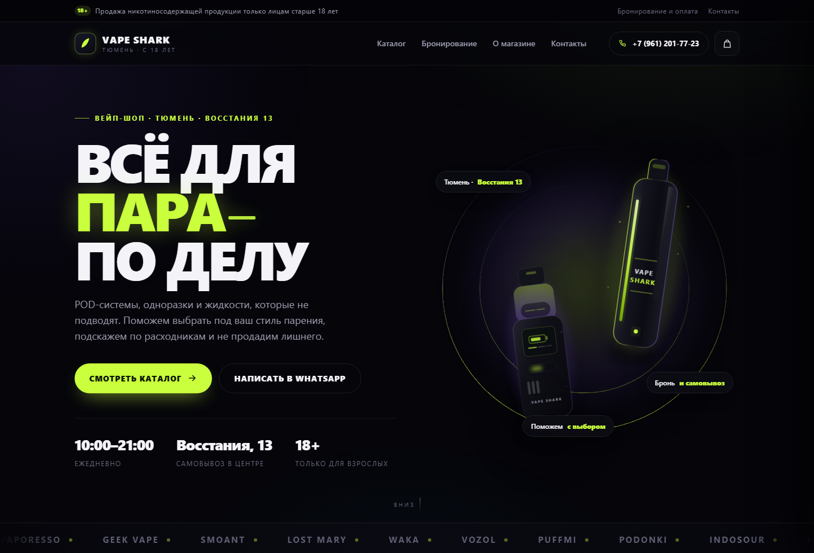

# Vape Shark — сайт вейп-шопа в Тюмени

**Опубликованная версия:** https://paperman15.github.io/vapeshark/
**Репозиторий:** https://github.com/Paperman15/vapeshark

Витрина с каталогом и корзиной для магазина **Vape Shark** (Тюмень, ул. Восстания, 13).
Заказ собирается на сайте и уходит в WhatsApp готовым сообщением — без бэкенда,
онлайн-оплаты и регистрации.

Оформление: тёмная неоновая тема, кислотный акцент, крупная типографика,
рисованные SVG-силуэты устройств вместо стоковых фото.



## Страницы

| Файл | Что внутри |
|---|---|
| `index.html` | Лендинг: первый экран, бренды, категории, хиты, «о магазине», три шага заказа, FAQ, адрес с картой |
| `catalog.html` | Каталог: категории, бренды, диапазон цен, поиск, сортировка, счётчики |
| `product.html?id=…` | Карточка товара: характеристики, количество, добавление в корзину, похожие товары |
| `cart.html` | Корзина и оформление: имя, телефон, способ получения, комментарий → WhatsApp |
| `delivery.html` | Доставка и оплата, возрастные ограничения, возврат и гарантия |
| `contacts.html` | Адрес, телефон, WhatsApp, соцсети, карта |
| `privacy.html` | Политика конфиденциальности (типовой текст) |

## Структура

```
vapeshark/
├── index.html · catalog.html · product.html · cart.html
├── delivery.html · contacts.html · privacy.html
├── css/
│   └── style.css          — вся тема, адаптив, анимации (один файл)
├── js/
│   ├── data.js            — контакты магазина (SITE) и каталог (PRODUCTS, CATEGORIES)
│   ├── app.js             — корзина, возрастной фильтр, карточки, модалки, тосты
│   ├── home.js            — подборка «Берут чаще всего» на главной
│   ├── catalog.js         — фильтры, поиск, сортировка
│   ├── product.js         — карточка товара
│   └── cart-page.js       — корзина и формирование заказа для WhatsApp
├── assets/
│   ├── favicon.svg
│   └── art/               — силуэты устройств и жидкостей (SVG)
├── preview.png
└── README.md
```

Внешних зависимостей нет: ни фреймворков, ни CDN, ни веб-шрифтов. Сайт работает
и с файла, и с любого статического хостинга.

## Как посмотреть

Откройте `index.html` в браузере — почти всё работает локально. Чтобы проверить
корзину и переходы по ссылкам «как на хостинге», запустите локальный сервер:

```bash
python -m http.server 8000
# затем http://127.0.0.1:8000
```

## Как менять контент

**Контакты и ссылки** — `js/data.js`, объект `SITE`: название, адрес, часы,
телефон, WhatsApp, Telegram, ВКонтакте, ссылки на карту. Telegram сейчас пустой —
если вписать `https://t.me/…`, кнопки подхватят ссылку (поле зарезервировано).

**Товары** — `js/data.js`, массив `PRODUCTS`. У товара есть `id`, `brand`, `name`,
`category`, `price`, необязательные `oldPrice` и `badges` (`Хит`, `Новинка`, `Скидка`),
короткое `meta`, `desc`, массив `specs` (пары «характеристика — значение») и `tags`
для поиска. Картинка выбирается автоматически по категории — свой силуэт для
одноразок, POD-систем, жидкостей, картриджей и аксессуаров, плюс индивидуальный
оттенок у каждого товара.

**Категории** — `CATEGORIES` в том же файле. Меняете `name`, и подпись обновится
в каталоге, фильтрах, крошках и на главной.

**Акцентный цвет** — переменная `--acid` в начале `css/style.css`
(`#c9ff3c`). От неё зависят кнопки, свечения, бейджи и рамки.

## Что работает

- Возрастной фильтр 18+ при первом входе (ответ запоминается в `localStorage`).
- Корзина: добавление, количество, удаление, сохранение между страницами и перезагрузками.
- Оформление: валидация имени и телефона, способ получения, комментарий — на выходе
  готовое сообщение в WhatsApp с составом заказа и суммой. Есть копирование текста,
  если мессенджер не открылся.
- Каталог: фильтры по категории и бренду, диапазон цен, поиск по названию, вкусу
  и характеристикам, сортировка, пустое состояние.
- Адаптив от 360 px, выезжающее меню, корзина-drawer, аккордеон FAQ.
- Карта Яндекса подгружается по кнопке — страница не тянет сторонние скрипты при старте.
- Метатеги, Open Graph, микроразметка `Store` для поисковиков.

## Важно перед публикацией

- **Цены и ассортимент демонстрационные.** Замените `PRODUCTS` на реальные позиции
  и актуальные цены — сейчас там 27 популярных товаров с правдоподобными
  характеристиками.
- **Проверьте часы работы.** Указано «ежедневно 10:00–21:00» по данным справочников;
  в некоторых источниках встречается другой график.
- **Условия доставки и возврата** на странице `delivery.html` — типовые формулировки.
  Приведите их в соответствие с тем, как магазин работает на самом деле.
- **Политика конфиденциальности** (`privacy.html`) — шаблон. Впишите реквизиты
  оператора (ИП/ООО, ИНН, адрес) и проверьте текст у юриста.
- Сайт содержит информацию о никотиносодержащей продукции: возрастной фильтр,
  пометка 18+ и оговорка «не является публичной офертой» уже на месте. Требования
  к рекламе такой продукции в России стоит перепроверить перед запуском.
- Домен и хостинг: подойдёт GitHub Pages, Netlify, Cloudflare Pages или обычный
  хостинг — загрузите папку целиком, точкой входа будет `index.html`.

## Публикация на GitHub Pages

```bash
git init
git add .
git commit -m "Vape Shark site"
git branch -M main
git remote add origin <ваш-репозиторий>
git push -u origin main
```

В настройках репозитория: *Settings → Pages → Deploy from a branch → main / root*.
Файл `.nojekyll` не нужен — в проекте нет каталогов с подчёркиванием.
